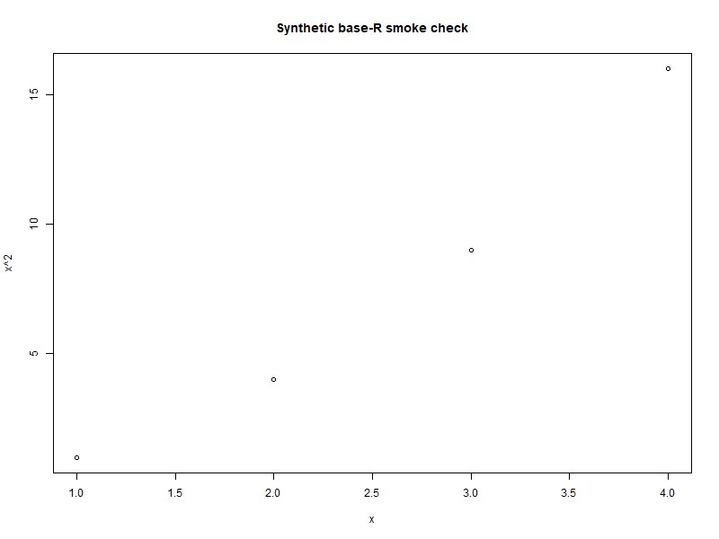
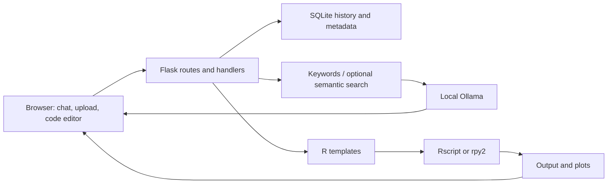

# BioStation AI

A local statistical-analysis assistant for bioscience students. Upload a table, explore its columns, generate R analysis code, and use a chat interface to ask for help selecting and interpreting statistical tests.

This is a **development prototype** built with Flask, vanilla JavaScript, R, Ollama and SQLite. The repository contains the integration code and 21 built-in statistical templates; it is not a validated statistical decision system.



*Actual plot generated through the Flask R-execution route on 17 October 2026, using x = 1, 2, 3, 4 and y = x². This verifies the R bridge; it is not an LLM response or a clinical result.*

## What the project demonstrates

- Flask blueprints separate chat, uploads, history, export, R execution and custom-test teaching.
- CSV/Excel upload handling builds a table preview, column information and summaries, then persists dataset metadata locally.
- A three-tier intent pipeline uses keyword matching, optional semantic retrieval, then an Ollama model (`phi3:mini` by default).
- R templates cover group comparisons, correlation, regression, categorical and survival analysis. Generated code can be inspected, edited and exported.
- Server-Sent Events stream chat responses; SQLite stores conversations and dataset metadata.



## Verified scope

On **17 October 2026**, local smoke checks exercised the real Flask application with disposable synthetic data: page rendering; a four-row CSV upload and preview; dataset session retrieval; conversation creation, retrieval and deletion; and generation of all 21 templates. Twenty exported successfully; the correlation-matrix export returned HTTP 404. A base-R subprocess check calculates a synthetic mean and creates a plot. This checks the execution bridge, not the statistical correctness of every template.

Ollama replies, semantic retrieval, model-driven repairs and end-to-end natural-language analysis were **not verified**. The existing error-parser unit suite is stale; see [verification evidence and exact results](docs/VERIFICATION.md). No accuracy or learning-outcome claim is made.

## Run locally

Use Python 3.10+ and a separate virtual environment. The pinned requirements reflect the original stack and include R integration plus substantial optional ML packages; compatibility with a fresh environment needs checking.

```powershell
python -m venv .venv
.\.venv\Scripts\Activate.ps1
pip install -r requirements.txt
```

Install R 4.x and required packages using `install_r_packages.R`; Excel uploads additionally need `openpyxl`/`xlrd`, which are absent from the requirements. Install Ollama separately, start its service, and pull `phi3:mini`. These are prerequisites, not bundled services.

```powershell
ollama pull phi3:mini
$env:SECRET_KEY = 'replace-with-a-random-local-value'
python run_biostation.py
```

Open `http://127.0.0.1:5000`. Start from the repository root: some storage paths depend on the working directory. Server/model settings live in [config.py](config.py); most are class values rather than environment overrides. The first semantic-model load and R package installation may require internet. The page also uses CDN assets.

To repeat the dependency-available smoke check without private data or an LLM request:

```powershell
python docs/verify_local.py
```

## Limits that affect use

The intent-to-handler mapping is incomplete: some requests fall back to general chat, group-comparison routing can select an unpaired t-test regardless of the named test, and correlation routing can retain Pearson. Templates guess column roles, sometimes alphabetically, and several need manual editing. Inspect the generated R before trusting a result. The UI exposes fewer analysis paths than the template catalog suggests.

Keep this app on loopback for trusted local experiments. It executes arbitrary R without a sandbox, stores plaintext history, uses a development secret fallback, and renders chat HTML without sufficient escaping. Local model processing does not make the whole interface fully offline. See the [preserved project guide](docs/PROJECT_GUIDE.md) for the detailed security, routing and dependency issue list.

## Provenance and documentation

This repository is collaborative work; commit history includes `takif0`, Emmanuel Nara and `faiyaadmahabub-hash`. This page describes the checked-in system and does not attribute every component to one contributor. The [full original guide](docs/PROJECT_GUIDE.md), [implementation plan](IMPLEMENTATION_PLAN.md) and [refactoring notes](REFACTORING_PROGRESS.md) retain the technical background. No license file is currently included; do not assume reuse permission.

