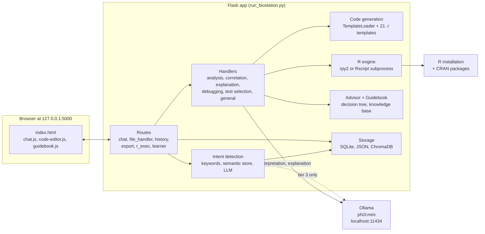
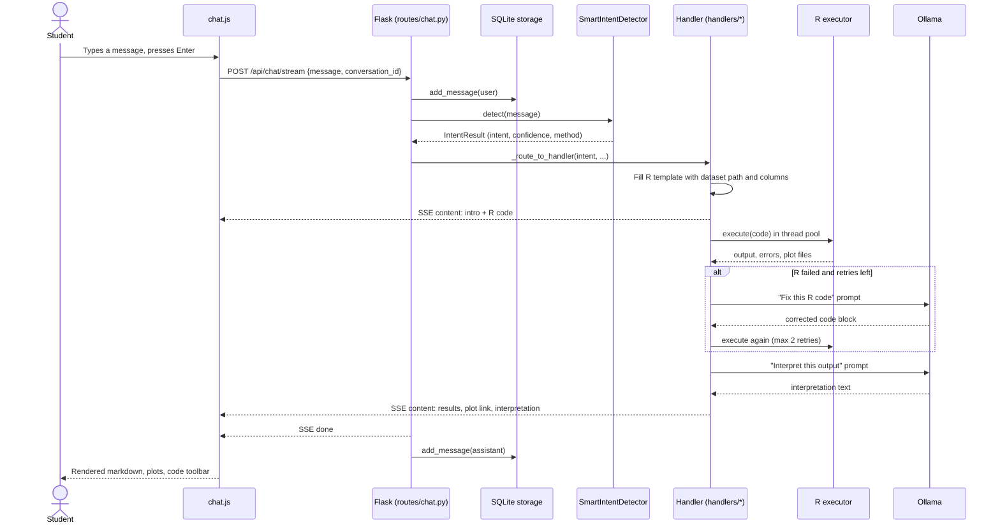
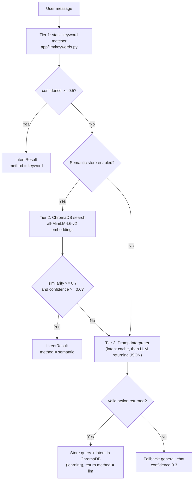
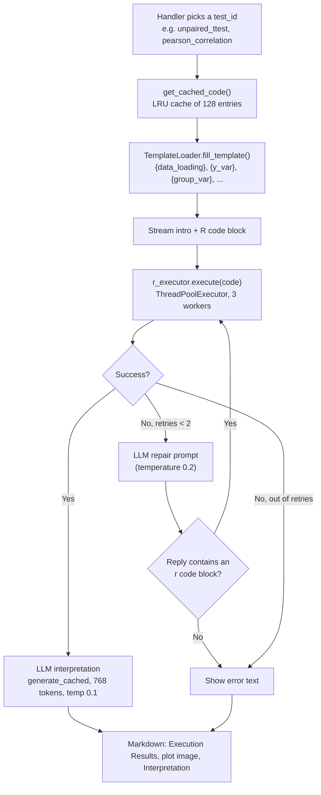
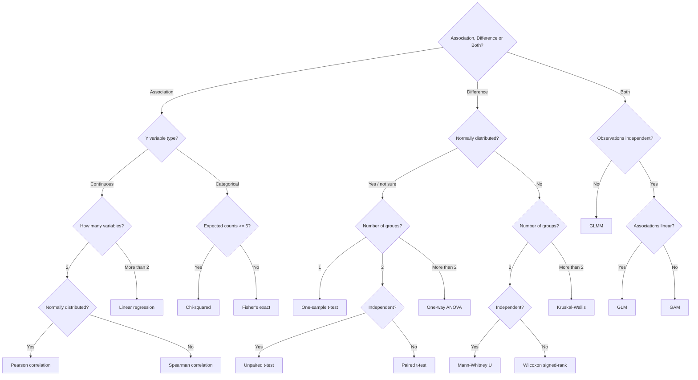

# BioStation AI: Statistical Analysis Assistant for Bioscience Students

A **local, privacy-first chatbot** that helps bioscience students choose a statistical test, run it in R, and understand the result. You upload a CSV or Excel file, ask a question in plain English ("compare my groups", "is there a correlation?"), and BioStation AI detects what you want, fills in a ready-made **R template** with your column names, runs it, shows the plots, and asks a **local LLM** to explain the output in plain language.

It is a Flask web app (vanilla JavaScript front end) built on **Ollama** (default model `phi3:mini`) for language understanding, **R** (via `rpy2` or `Rscript`) for the statistics, **ChromaDB + sentence-transformers** for a small "learning" intent store, and **SQLite** for chat history. Your data and the LLM stay on your machine.

---

## Table of contents

1. [What it does](#what-it-does)
2. [Architecture](#architecture)
3. [How a chat message is handled](#how-a-chat-message-is-handled)
4. [Intent detection (three tiers)](#intent-detection-three-tiers)
5. [The analysis pipeline](#the-analysis-pipeline)
6. [Statistical tests and R templates](#statistical-tests-and-r-templates)
7. [Test advisor (decision tree)](#test-advisor-decision-tree)
8. [Teach mode (custom tests)](#teach-mode-custom-tests)
9. [HTTP API](#http-api)
10. [Data and storage](#data-and-storage)
11. [Project structure](#project-structure)
12. [Setup and run](#setup-and-run)
13. [Configuration reference](#configuration-reference)
14. [Code walkthrough](#code-walkthrough)
15. [Example usage](#example-usage)
16. [Testing](#testing)
17. [Troubleshooting](#troubleshooting)
18. [Security and privacy notes](#security-and-privacy-notes)
19. [Issues](#issues)
20. [Next steps](#next-steps)

---

## What it does

- **Chat interface** with conversation history (rename, delete, grouped by Today / Yesterday / Previous 7 Days / Previous 30 Days), streaming replies (Server-Sent Events) and a stop button.
- **Dataset upload and preview** for `.csv`, `.txt`, `.xlsx` and `.xls` files (up to 10 preview rows, column types, numeric summaries, missing-value report).
- **Intent detection** that copes with typos and vague wording: keyword matching first, then a ChromaDB semantic search, then the local LLM as a last resort.
- **R code generation from templates**: 21 built-in `.r` templates (t-tests, ANOVA, non-parametric tests, correlation, chi-squared / Fisher, linear / generalised / mixed / additive models, survival analysis, normality, descriptive statistics) filled with your dataset path and column names. See [Known issues](#known-issues-and-limitations) for which of them the chat currently reaches.
- **R execution** with captured output and plots, **automatic error recovery** (the LLM is asked to repair failing code, up to 2 retries) and an **LLM-written interpretation** that includes the test assumptions.
- **Code editor modal**: copy, download as `analysis.R`, run, and explain any R code block from the chat.
- **Error debugging**: regex-based explanation of common R errors with suggested fixes (`app/debugger`, `app/r_engine/error_analyzer.py`).
- **Test advisor**: a flowchart-style decision tree (association vs difference, variable types, distribution, sample size) that recommends a test (reached through `POST /api/chat`, see [Known issues](#known-issues-and-limitations)).
- **Guidebook**: an in-app "AI Capability Guide" panel with example prompts plus a small knowledge base of concepts (p-values, effect size, normality, multiple comparisons, power, assumptions).
- **Teach mode**: add your own statistical tests (keywords, explanation, assumptions, R template) from the UI; they are stored in JSON and used immediately.

| Technology | Role |
|---|---|
| Python 3.10+ | Language (the code uses `str \| Generator` type hints) |
| Flask 3.0.0 / Werkzeug 3.0.1 | Web server, blueprints, sessions |
| Ollama (`ollama` Python client 0.1.6) | Local LLM runtime; default model `phi3:mini` at `http://localhost:11434` |
| R 4.x (`rpy2` 3.5.15 or `Rscript`) | Executes the generated statistics code |
| ChromaDB 0.4.22 + sentence-transformers 2.3.1 | Semantic intent store, embedding model `all-MiniLM-L6-v2` |
| SQLite (standard library) | Chat history, dataset metadata, intent cache |
| pandas 2.1.4 / numpy 1.26.3 | Upload parsing, previews, data validation |
| cachetools | 5-minute TTL cache for LLM interpretations |
| Vanilla JavaScript, CSS | Front end (no build step); Prism.js 1.29.0 for code highlighting |

---

## Architecture



Everything runs on `127.0.0.1`. The only outbound network traffic is incidental: Google Fonts, Material Icons and Prism.js are loaded from CDNs by `index.html`, the embedding model is downloaded from Hugging Face the first time the semantic store starts, and missing R packages are installed from CRAN the first time a template needs them.

---

## How a chat message is handled

The UI uses `POST /api/chat/stream`. The sequence below follows an analysis request such as "compare my groups".



Two routing details are worth knowing:

- `/api/chat/stream` sends only the analysis intents (`descriptive_stats`, `compare_groups`, `correlation`, `correlation_matrix`, `regression`, `debug_error`, `post_hoc`), or any message that contains a built-in or custom test keyword with an existing template, through the handler pipeline. Every other message is streamed token by token straight from the LLM with the `GENERAL_ASSISTANT` system prompt plus the active dataset's column names.
- `/api/chat` (non-streaming, returns one JSON object) routes **every** intent through the handlers. The bundled front end does not call it.

---

## Intent detection (three tiers)

`app/llm/smart_intent_detector.py` classifies a message with a cascade, cheapest first.



**Tier 1, keywords.** `INTENT_KEYWORDS` defines 16 intents (`compare_groups`, `correlation`, `correlation_matrix`, `regression`, `descriptive_stats`, `categorical_test`, `normality_test`, `explain_concept`, `test_selection`, `code_generation`, `debug_error`, `data_operation`, `visualization`, `power_analysis`, `post_hoc`, `survival_analysis`), each with `primary`, `secondary` and `phrases` lists. Scoring: a phrase match adds 1.5, a primary keyword 1.0, a secondary keyword 0.3 (only for intents that already matched). Confidence is `min(score / 2, 1.0)`; the intent with the highest score wins. Matching is a plain substring test on the lower-cased message.

**Tier 2, semantic search.** `app/llm/semantic_store.py` keeps a ChromaDB collection called `user_intent_history` under `data/intent_store/`. It is seeded with 33 example queries on first start; every query resolved by the LLM in tier 3 is stored too, so the system learns your phrasing. If `chromadb` or `sentence-transformers` cannot be imported, the store disables itself and the cascade skips tier 2.

**Tier 3, LLM.** `app/llm/prompt_interpreter.py` first tries a few instant keyword shortcuts (greetings, mean/variance, t-test, correlation, ANOVA, error words), then a SQLite cache (`intent_cache` table), then asks the model (temperature 0.1) to answer with JSON containing `action`, `understood_as`, `parameters` and `confidence`.

Typos such as "compre my grops" are the reason tiers 2 and 3 exist; the prompt's few-shot examples include exactly that case.

---

## The analysis pipeline

`app/handlers/base.py::execute_and_interpret_result` is the shared engine behind every analysis handler. It is a generator, so each step streams to the browser as soon as it is ready.



**Column mapping.** The generator does not parse your question for column names. It guesses roles from the column list the handler passes in: the **last** column becomes the outcome (`y`), the **first** column becomes the predictor / grouping variable (`x`, `group`), and for two-way ANOVA the second column becomes the second factor. The handlers pass `sorted(column_names)`, so "first" and "last" are alphabetical, not file order. Edit the generated code in the code editor modal when the guess is wrong.

**R executor.** `app/r_engine/__init__.py` chooses `rpy2` when it imports successfully and otherwise the `Rscript` subprocess executor.

- `executor.py` (rpy2) evaluates the code in-process and opens a `jpeg()` device in `data/plots/`.
- `subprocess_executor.py` writes the script to `data/temp_r/`, runs `Rscript --vanilla` with a 60-second timeout, wraps it with a `jpeg()` device (800 x 600, quality 90, saved as `data/plots/plot_<milliseconds>.jpg`) and rewrites every `library(pkg)` call into `ensure_package("pkg"); library(pkg)` so missing packages are installed from CRAN. Plots smaller than 1000 bytes are discarded. The code only looks for Rscript in Windows locations (`C:\Program Files\R\...` and `where Rscript`).
- `OutputParser` extracts p-values, t, F, df and correlation values with regular expressions (used by `/api/run-code`).

---

## Statistical tests and R templates

All templates live in `app/code_gen/templates/` as plain `.r` files. Placeholders use Python `str.format` syntax, so literal R braces are written `{{ }}`. Every template starts with `{package_helper}` (an `ensure_package()` function), then `{data_loading}` (`read.csv(...)` or `read_excel(...)`).

| Category | Test ID | Template | What it runs |
|---|---|---|---|
| T-tests | `one_sample_ttest` | `ttests/one_sample_ttest.r` | Shapiro-Wilk, `t.test(mu=...)`, Cohen's d, histogram + density |
| | `unpaired_ttest` | `ttests/unpaired_ttest.r` | Per-group Shapiro-Wilk, `var.test`, Welch `t.test`, Cohen's d, boxplot |
| | `paired_ttest` | `ttests/paired_ttest.r` | Differences, Shapiro-Wilk, paired `t.test`, Cohen's d, before/after plot |
| ANOVA | `anova` | `anova/one_way_anova.r` | Shapiro-Wilk, Levene (`car`), `aov`, eta-squared, Tukey HSD, Bonferroni / Holm / FDR pairwise tests |
| | `two_way_anova` | `anova/two_way_anova.r` | Levene, Type II `Anova`, partial eta-squared, `emmeans` post-hoc (Tukey, Bonferroni, Holm, FDR), interaction plot |
| Non-parametric | `mann_whitney` | `nonparametric/mann_whitney.r` | `wilcox.test`, approximate effect size r, medians, violin + box plot |
| | `wilcoxon_signed_rank` | `nonparametric/wilcoxon_signed_rank.r` | Paired `wilcox.test`, median difference |
| | `kruskal_wallis` | `nonparametric/kruskal_wallis.r` | `kruskal.test`, Dunn's test (Bonferroni, Holm, BH) |
| Correlation | `pearson_correlation` | `correlation/pearson_correlation.r` | `cor.test(method="pearson")`, scatter + linear fit |
| | `spearman_correlation` | `correlation/spearman_correlation.r` | `cor.test(method="spearman")`, scatter + loess |
| | `correlation_matrix` | `correlation/correlation_matrix.r` | `Hmisc::rcorr` (Pearson or Spearman), p-value matrix, significance stars, ggplot2 heatmap |
| Categorical | `chi_squared` | `categorical/chi_squared.r` | Contingency table, expected counts, `chisq.test`, Cramer's V, mosaic plot |
| | `fisher_exact` | `categorical/fisher_exact.r` | `fisher.test`, odds ratio for 2x2 tables |
| Regression | `linear_regression` | `regression/linear_regression.r` | `lm`, confidence intervals, diagnostic plots, VIF |
| | `glm` | `regression/glm.r` | `glm` (binomial or Poisson), odds ratios, AIC, deviance |
| | `glmm` | `regression/glmm.r` | `lme4::glmer` with random intercept, `lmerTest`, odds ratios |
| | `gam` | `regression/gam.r` | `mgcv::gam` with `s()` smooth, concurvity, `gam.check` |
| Survival | `kaplan_meier` | `survival/kaplan_meier.r` | `survfit`, log-rank test, `survminer::ggsurvplot` |
| | `cox_regression` | `survival/cox_regression.r` | `coxph`, hazard ratios, `cox.zph`, forest plot |
| Diagnostics | `normality_test` | `diagnostics/normality_test.r` | Shapiro-Wilk, Anderson-Darling (`nortest`), skewness / kurtosis (`moments`), Q-Q plot, histogram |
| | `descriptive` | `diagnostics/descriptive.r` | `str`, `summary`, mean / median / SD / variance / min / max, histogram |

`app/advisor/test_knowledge.py` holds a matching 21-entry knowledge base (purpose, when to use, assumptions, interpretation, R function, common mistakes) that powers the explanation and recommendation texts. `app/handlers/base.py` maps natural-language keywords (`"t-test"`, `"mann whitney"`, `"tukey"`, `"fisher"`, ...) to test IDs (`_BUILTIN_TEST_MAPPING`).

---

## Test advisor (decision tree)

`app/advisor/decision_tree.py` encodes the flowchart. The recommendation text comes from `test_knowledge.py`; `handle_test_selection` asks one question at a time and matches your reply to the options by case-insensitive partial match.



The tree position is held in one module-level singleton, so it is shared by every browser tab. `POST /api/reset` returns it to the start; so do the phrases "start over" / "reset" when they reach `handle_general` (the non-streaming route).

---

## Teach mode (custom tests)

Click the graduation-cap icon in the top bar to open **Teach BioStation AI**.

1. **Add Test** tab: enter a name, comma-separated keywords, a one-line purpose, an explanation and assumptions (both are given to the LLM when it interprets the output), and an R template.
2. The template must use the same placeholders as the built-in ones (`{package_helper}`, `{data_loading}`, `{data}`, `{y_var}`, `{group_var}`, `{subject_var}`, ...; the full list is `VALID_PLACEHOLDERS` in `app/guidebook/dynamic_loader.py`) and double the braces of R control structures.
3. **Validate R Code** (`POST /teach/validate`) checks balanced `()`, `[]`, `{}` (after ignoring `{{ }}`) and that every `{placeholder}` is known. It is a lightweight check, not an R parser.
4. On save the test gets an ID like `custom_1a2b3c4d`, an auto-detected category (parametric, non-parametric, regression, ...), the list of R packages found in the template, and is written to `data/knowledge/custom_tests.json`. The caches are refreshed, so a message that contains one of your keywords is routed to your template at once.
5. **Manage Tests** tab lists, edits and deletes the custom tests.

The repository ships with one example, a **Friedman test** template (`data/knowledge/custom_tests.json`) that auto-reshapes wide data to long format and runs `friedman.test`, Kendall's W (`rstatix`) and pairwise Wilcoxon post-hoc tests.

---

## HTTP API

All routes are served from `http://127.0.0.1:5000`.

| Method and path | Purpose |
|---|---|
| `GET /` | Chat page (`templates/index.html`) |
| `POST /api/chat` | Non-streaming chat. Body `{message, conversation_id?}`. Returns `{response, action, understood_as, confidence, success}` |
| `POST /api/chat/stream` | Streaming chat (SSE). Events: `thinking`, `content`, `done`, `error` |
| `POST /api/reset` | Reset the advisor decision tree and clear the Flask session |
| `POST /api/upload` | Multipart upload (`file`, optional `conversation_id`). Allowed: csv, txt, xlsx, xls. Returns rows, columns, column names and a preview |
| `GET /api/dataset-info` | Active dataset (from session, else from SQLite) |
| `GET /api/dataset-preview` | Preview of the active dataset |
| `POST /api/dataset-preview/refresh` | Regenerate the preview from the file on disk |
| `GET /api/conversations`, `POST /api/conversations` | List (grouped by time) / create conversations |
| `GET`, `PUT`, `DELETE /api/conversations/<conv_id>` | Read with messages / rename / delete |
| `POST /api/run-code` | Run R code. Returns output, errors, plot file names, extracted statistics and, on failure, an error analysis |
| `GET /api/plot/<filename>` | Serve an image from `data/plots/` |
| `POST /api/debug-code` | Pattern-based error explanation and fix suggestion |
| `POST /api/explain-code`, `POST /api/explain-code/stream` | LLM explanation of R code (JSON / SSE) |
| `POST /api/code-summary` | Instant, non-LLM summary of R code (lines, packages, detected test) |
| `GET /api/export/r-code/<test_id>` | Download a generated template as `<test-id>_analysis.R` (underscores become hyphens) |
| `POST /api/export/code` | Echo posted code back as a download |
| `GET /api/available-tests` | List built-in tests from the knowledge base |
| `GET /api/guidebook/topics` | List guidebook concepts |
| `POST /teach`, `GET /teach/tests`, `GET`, `PUT`, `DELETE /teach/tests/<test_id>` | Create, list, read, update, delete custom tests |
| `POST /teach/validate`, `POST /teach/refresh-cache` | Validate a template / reload caches |
| `POST /api/validate-data`, `POST /api/suggest-tests` | Data validation and test suggestions (see [Known issues](#known-issues-and-limitations)) |

`app/routes/datasets.py` defines `/api/datasets...` endpoints for a built-in dataset library (iris, mtcars, ToothGrowth, PlantGrowth, ChickWeight, sleep, airquality, faithful), but that blueprint is **not registered** in `app/__init__.py`, so those URLs return 404 today.

---

## Data and storage

Everything the app writes goes under `data/`. Paths are relative to the project root, so **start the app from the project root** (see [Troubleshooting](#troubleshooting)).

| Path | What it is |
|---|---|
| `data/database/chats.db` | SQLite: `conversations` (id, title, timestamps) and `messages` (role, content, timestamp). Conversation IDs are the first 8 characters of a UUID |
| `data/chats.db` | SQLite: `datasets` (filename, absolute file path, column names, row count, preview JSON, active flag) and `intent_cache` (hashed user input to LLM interpretation). `dataset_storage.py` and `intent_cache.py` open this file through a hard-coded relative path |
| `data/user_datasets/` | Uploaded files (`UPLOAD_FOLDER`). Contains the sample `aphids.csv` (50 leaves x 10 trees of counts, wide format) and `test_2way.csv` (2 x 2 factorial growth data), plus `weather.csv` (about 4 MB of hourly surface weather observations for one New York station, in what looks like the NOAA Global Hourly format) |
| `data/plots/` | Figures produced by R runs: 800 x 600 JPEG (earlier runs PNG), named `plot_<timestamp>.jpg`. Sampled files are the Pearson scatter plot with regression line, the correlation-matrix heatmap and the descriptive histogram for the aphid data; about a third are identical blank white images from runs where nothing was drawn |
| `data/intent_store/` | The **active** ChromaDB store (`chroma.sqlite3` plus HNSW index files): collection `user_intent_history` with the 33 seed queries and the queries the LLM resolved. Created by `semantic_store.py` via `chat.py` |
| `data/chroma/intent_store/` | An older ChromaDB store with the seed queries only. The current code does not read it; `CHROMA_DB_PATH` (`data/chroma`) is only created as an empty directory |
| `data/knowledge/custom_tests.json` | Tests created in teach mode (shipped with the Friedman test example). `custom_concepts.json` is read if present but nothing in the UI writes it |
| `data/logs/biostation.log` | Application log (created at start-up) |
| `data/temp_r/` | Temporary R scripts for the `Rscript` executor |

The ChromaDB store, SQLite databases, plots and uploads are **runtime state**: they are regenerated (the seed queries are re-created when the collection is empty) and are not version-controlled (they are listed in `.gitignore`). See the [security and privacy notes](#security-and-privacy-notes).

---

## Project structure

```
Biostation-Ai-Chatbot/
├── run_biostation.py            # Entry point: builds the app, pre-warms the LLM, starts Flask
├── config.py                    # Config classes (development / production), paths, LLM and R settings
├── requirements.txt             # Pinned Python dependencies
├── install_r_packages.R         # Installs the R packages the templates rely on
├── test_2way.csv                # Small two-way ANOVA sample (copy also in data/user_datasets/)
├── IMPLEMENTATION_PLAN.md       # 15-phase feature roadmap (phases 1-4 ticked)
├── REFACTORING_PROGRESS.md      # Notes from the generator/handler refactor
│
├── app/
│   ├── __init__.py              # create_app(): config, folders, logging, blueprints
│   ├── routes/
│   │   ├── chat.py              # /, /api/chat, /api/chat/stream, /api/reset, routing to handlers
│   │   ├── file_handler.py      # Upload, dataset info and preview
│   │   ├── history.py           # Conversation CRUD
│   │   ├── r_exec.py            # Run R code, plots, debug, explain code
│   │   ├── export.py            # R code download, test and topic lists
│   │   ├── learner.py           # Teach mode CRUD and validation
│   │   └── datasets.py          # Built-in dataset library (NOT registered)
│   ├── llm/
│   │   ├── ollama_client.py     # Ollama wrapper: generate, stream, history, 5-minute cache
│   │   ├── prompts.py           # System prompts and prompt builders
│   │   ├── keywords.py          # Tier 1 keyword matcher
│   │   ├── semantic_store.py    # Tier 2 ChromaDB store
│   │   ├── prompt_interpreter.py# Tier 3 LLM interpreter (JSON output)
│   │   └── smart_intent_detector.py  # Cascade orchestrator
│   ├── handlers/
│   │   ├── base.py              # Test mapping, code cache, execute-and-interpret pipeline
│   │   ├── analysis.py          # Descriptive statistics, group comparison
│   │   ├── correlation.py       # Pairwise correlation and correlation matrix
│   │   ├── code_generation.py   # Template-based code requests, test menu
│   │   ├── code_explanation.py  # LLM code explanations, quick code summary
│   │   ├── explanation.py       # Concept explanations, post-hoc corrections
│   │   ├── test_selection.py    # Decision-tree conversation
│   │   ├── debugging.py         # R error explanation
│   │   └── general.py           # Fallback LLM chat, reset phrases
│   ├── code_gen/
│   │   ├── generator.py         # Column-role guessing, delegates to TemplateLoader
│   │   ├── template_loader.py   # TEMPLATE_MAP, placeholder filling, custom templates
│   │   └── templates/           # 21 R templates in 8 folders + helpers/package_installer.r
│   ├── r_engine/
│   │   ├── executor.py          # rpy2 executor, OutputParser
│   │   ├── subprocess_executor.py  # Rscript executor (Windows lookup)
│   │   ├── validator.py         # DataValidator (size limits, missing values, test suggestions)
│   │   └── error_analyzer.py    # Error patterns, fuzzy column fixes, template checks
│   ├── advisor/
│   │   ├── decision_tree.py     # Test-selection flowchart
│   │   └── test_knowledge.py    # 21 StatisticalTest entries
│   ├── guidebook/
│   │   ├── knowledge_base.py    # 7 static concepts and search
│   │   └── dynamic_loader.py    # Custom tests / concepts (JSON), template validation
│   ├── debugger/error_parser.py # Regex parser for common R errors
│   ├── chat_storage_manager/    # chat_storage.py, dataset_storage.py, intent_cache.py
│   ├── datasets/                # Built-in dataset registry and loader (used by datasets.py only)
│   ├── preview/data_preview.py  # Preview payload for uploaded data
│   ├── templates/index.html     # Single-page UI and modals
│   └── static/
│       ├── css/                 # style.css, guidebook.css
│       └── js/                  # chat.js, code-editor.js, guidebook.js
│
├── data/                        # Runtime data (see "Data and storage")
└── tests/
    ├── conftest.py              # Shared fixtures (mock LLM client, config)
    ├── unit/test_error_parser.py
    ├── integration/test_chat_workflow.py
    └── fixtures/README.md
```

---

## Setup and run

### 1. Prerequisites

| Requirement | Notes |
|---|---|
| Python 3.10 or newer | `python --version` |
| [Ollama](https://ollama.ai) | The local LLM runtime; must be running on `localhost:11434` |
| R 4.x | Needed to run any analysis. On Windows the `Rscript` fallback looks in `C:\Program Files\R\R-*\bin` and on `PATH`; on macOS / Linux you need a working `rpy2` |
| Internet, first run only | Embedding model (Hugging Face) and R packages (CRAN) are downloaded when first needed |

The previous README suggested 16 GB RAM and 10 GB free disk; that figure is not enforced anywhere in the code, but `phi3:mini` plus the embedding model is comfortable on a modern laptop.

### 2. Get the code

```bash
git clone https://github.com/faiyaadmahabub-hash/Biostation-Ai-Chatbot.git
cd Biostation-Ai-Chatbot
```

### 3. Pull the model

```bash
ollama pull phi3:mini
```

### 4. Install Python dependencies

```bash
python -m venv .venv

# Windows
.venv\Scripts\activate
# macOS / Linux
source .venv/bin/activate

pip install -r requirements.txt
```

`requirements.txt` pins `Flask==3.0.0`, `Werkzeug==3.0.1`, `ollama==0.1.6`, `chromadb==0.4.22`, `sentence-transformers==2.3.1`, `rpy2==3.5.15`, `pandas==2.1.4`, `numpy==1.26.3`, `cachetools>=5.3.0` and a few packages the code never imports (`langchain`, `langchain-community`, `python-dotenv`, `requests`, `pyarmor`). If `rpy2` fails to build on Windows, remove that line: the app falls back to `Rscript` automatically (expected behaviour based on `app/r_engine/__init__.py`). Excel uploads additionally need `openpyxl` (`.xlsx`) or `xlrd` (`.xls`), which are not in the file (expected pandas requirement).

### 5. Install the R packages

```bash
Rscript install_r_packages.R
```

The script installs `dplyr`, `tidyr`, `readr`, `readxl`, `ggplot2`, `car`, `lme4`, `lmerTest`, `mgcv`, `multcomp`, `dunn.test`, `nortest`, `moments`, `survival`, `survminer` and `broom`. The templates also use `emmeans`, `reshape2` and `Hmisc` (two-way ANOVA and correlation matrix), and the Friedman example uses `rstatix` and `tidyverse`. They are installed automatically on first use, but that can exceed the 60-second `Rscript` time-out, so installing them up front is advisable.

### 6. Start the app

```bash
python run_biostation.py
```

The console prints the version, model and URL, then pre-warms the model in a background thread so the first real question is faster. Open **http://127.0.0.1:5000**.

### 7. Upload data and ask a question

Click the paperclip, choose a CSV or Excel file, then type a request (see [Example usage](#example-usage)).

---

## Configuration reference

Only two environment variables are read by the code. Everything else is set in `config.py`.

| Variable | Default | Effect |
|---|---|---|
| `FLASK_ENV` | `development` | `development` (also used for any unknown value) enables Flask debug mode and DEBUG logging; `production` turns debug off and logs at WARNING |
| `SECRET_KEY` | built-in development key | Signs the Flask session cookie. **Set your own value** (`SECRET_KEY=<your-random-string>`) for anything beyond a personal laptop |

Example:

```bash
# macOS / Linux
export FLASK_ENV=production
export SECRET_KEY=<your-random-string>
python run_biostation.py
```

Settings that are actually used from `config.py`:

| Setting | Default | Used for |
|---|---|---|
| `HOST`, `PORT` | `127.0.0.1`, `5000` | Where Flask listens (edit the file to change) |
| `LLM_MODEL` | `phi3:mini` | Ollama model name |
| `OLLAMA_BASE_URL` | `http://localhost:11434` | Ollama endpoint |
| `LLM_TEMPERATURE` | `0.3` | Temperature for general chat and explanations |
| `UPLOAD_FOLDER` | `data/user_datasets` | Where uploads are saved |
| `ALLOWED_EXTENSIONS` | `csv, txt, xlsx, xls` | Upload filter |
| `SQLITE_DB_PATH` | `data/database/chats.db` | Chat history database |
| `LOG_FILE`, `LOG_LEVEL` | `data/logs/biostation.log`, `INFO` | Logging |

`LLM_MAX_TOKENS`, `LLM_CONTEXT_WINDOW`, `OLLAMA_TIMEOUT`, `MAX_UPLOAD_SIZE`, `R_HOME`, `R_TIMEOUT`, `SESSION_TIMEOUT`, `EMBEDDING_MODEL`, `CHROMA_COLLECTION_NAME`, `KNOWLEDGE_BASE_PATH` and `GUIDEBOOK_DOCS_DIR` are defined but not referenced elsewhere in the code. The effective values are in the modules (for example the 60-second R time-out in `subprocess_executor.py` and the `all-MiniLM-L6-v2` model name in `semantic_store.py`).

---

## Code walkthrough

### `run_biostation.py` and `config.py`

`create_app(config_name=os.getenv('FLASK_ENV', 'development'))` builds the Flask app. In `__main__` the script prints a banner, starts a daemon thread that sends a one-token "Hello" to Ollama (model pre-warming) and calls `app.run(host, port, debug)`.

### `app/__init__.py`

The application factory loads the config class, creates the folders (`UPLOAD_FOLDER`, log directory, `CHROMA_DB_PATH`, the database directory), attaches a file and a console log handler and registers six blueprints: `chat_bp`, `file_bp`, `history_bp`, `export_bp`, `r_exec_bp`, `learner_bp`.

### `app/llm/`

- `OllamaClient` wraps `ollama.Client`. On construction it lists the installed models (warning if `phi3:mini` is missing) and runs `ollama ps` to log whether the GPU is in use. `generate()` supports streaming; `generate_cached()` keys a `TTLCache` (100 entries, 5 minutes) on model + system prompt + prompt; `generate_with_history()` keeps the last 10 messages.
- `PromptTemplates` holds the system prompts: statistical advisor, code generator, error debugger, guidebook synthesiser, code explainer and the `GENERAL_ASSISTANT` prompt, which restricts the bot to biostatistics and R and tells it to decline unrelated topics.
- `keywords.py`, `semantic_store.py`, `prompt_interpreter.py` and `smart_intent_detector.py` implement the cascade described above.

### `app/routes/chat.py`

`_detect_intent` builds the detector singleton (persisting ChromaDB in `data/intent_store`), `_route_to_handler` maps intents to handlers (custom-test keywords are checked first), and `chat_stream` wraps either the pipeline generator or a direct LLM stream in SSE events.

| Intent | Handler | Result |
|---|---|---|
| `descriptive_stats` | `handle_descriptive_stats` | `descriptive` template, run and interpreted |
| `compare_groups` | `handle_comparison` | A group-comparison template (see [Known issues](#known-issues-and-limitations)) |
| `correlation` | `handle_correlation` | `pearson_correlation` (or `spearman_correlation` when a method is passed) |
| `correlation_matrix` | `handle_correlation_matrix` | Heatmap template, Pearson or Spearman |
| `regression` | `handle_code_generation("regression")` | `linear_regression` template |
| `test_selection` | `handle_test_selection` | Decision-tree question or recommendation |
| `explain_concept` | `handle_explanation` | Knowledge-base text, guidebook concept, or LLM |
| `debug_error` | `handle_error_debug` | Regex-parsed explanation |
| `post_hoc` | `handle_post_hoc` | Canned explanations: Bonferroni, Holm, FDR / Benjamini-Hochberg, Tukey, overview |
| custom test keyword | `handle_code_generation(message)` | Your taught template |
| anything else | `handle_general` | Free LLM answer with dataset columns in the system prompt |

### `app/handlers/`

`base.py` contains the shared pipeline shown earlier plus the built-in assumptions text for 11 tests, the keyword to test-ID mapping and the code cache. The other modules are thin: each checks that a dataset is loaded (otherwise it answers "Please upload a dataset first"), picks a test ID and hands over to `execute_and_interpret_result`. `code_explanation.py` detects the test type from the code (`t.test(`, `aov(`, `wilcox.test(`, `coxph(`, ...) for the explain button.

### `app/code_gen/`

`TemplateLoader.TEMPLATE_MAP` maps test IDs to files; custom tests from `data/knowledge/custom_tests.json` take precedence. `fill_template` builds `{data_loading}` (`read.csv` for `.csv`, `readxl::read_excel` for Excel), cleans variable names and calls `template.format(**replacements)`. `RCodeGenerator.generate_code` guesses column roles as described in [The analysis pipeline](#the-analysis-pipeline).

### `app/r_engine/`

`executor.py`, `subprocess_executor.py` and `__init__.py` are described above. `validator.py` offers `DataValidator.validate` (100,000-row / 500-column limits, duplicate columns, per-column type and missing-value summary, ID-column warning), `preprocess` (R-safe column names, duplicates, missing values) and `suggest_tests`. `error_analyzer.py` maps R error messages to explanations and, for some types, produces a corrected script (fuzzy-matches a missing column name against your columns, doubles template braces, adds `ensure_package`).

### `app/advisor/`, `app/guidebook/`, `app/debugger/`

The decision tree and knowledge base are plain Python data. `knowledge_base.py` holds seven concepts (normality, p-value, effect size, parametric vs non-parametric, multiple comparisons, sample size, assumptions) searched by title, keyword and content. `dynamic_loader.py` merges them with `custom_concepts.json` and manages custom tests. `error_parser.py` recognises ten R error families (object not found, undefined columns, non-numeric, missing package, function not found, formula, dimension mismatch, NA values, sample size, syntax).

### `app/chat_storage_manager/`

`ChatStorage` (SQLite) creates the two history tables, auto-titles a conversation from the first 40 characters of its first user message and groups conversations by time for the sidebar. `dataset_storage.py` remembers the active dataset so a lost session can be recovered. `intent_cache.py` stores LLM interpretations keyed by an MD5 of the normalised input.

### Front end

- `chat.js`: conversation sidebar, sending and streaming, file upload, dataset preview modal (Data / Columns / Statistics tabs), the Teach modal, markdown-ish rendering with code-block toolbars (copy, open in editor), thinking indicators.
- `code-editor.js`: editor modal (copy, download `analysis.R`, explain, run), plot viewer, client-side error patterns and the error-explanation modal (apply fix, copy fix, ask AI).
- `guidebook.js`: the self-contained "AI Capability Guide" side panel with a searchable catalogue of tests and example prompts; clicking a prompt copies it and pastes it into the chat box.

---

## Example usage

Try the bundled dataset `data/user_datasets/aphids.csv` (columns `leaf`, `tree01` ... `tree10`).

| You type | What happens |
|---|---|
| `Which statistical test should I use?` | Advisor question (association, difference or both) when sent through `POST /api/chat`; in the streaming web UI this message contains no test keyword, so the LLM answers it freely |
| `do correlation` | Intent `correlation`: runs the Pearson template on the first and last column (`leaf` and `tree10`), draws a scatter plot with a regression line, then explains r and p |
| `show correlation matrix` | Intent `correlation_matrix`: Pearson matrix of all numeric columns, p-values, significant pairs and a heatmap |
| `calculate the mean and variance` | Intent `descriptive_stats`: `summary`, mean, median, SD, variance, histogram |
| `explain anova in detail` | Knowledge-base explanation of one-way ANOVA (without "detail" you get the two-sentence version) |
| `explain the bonferroni correction` | Post-hoc explanation with R snippets |
| `Error in eval(expr) : object 'mydata' not found` | Parsed error with likely cause and suggestions |
| `run friedman test` | Routed to the taught Friedman template |

A successful analysis reply is streamed in this order:

````
Running **Pearson Correlation** analysis.
**Purpose**: ...

## R Code
```r
# generated, commented R code with your file path and columns
```

## Execution Results
**Analysis completed successfully.**
(printed R output, truncated to 1000 characters)


## Interpretation
**Statistical Conclusion:** ...
**Biological/Scientific Meaning:** ...
**Importance:** ...
**Assumptions & Conditions:** ...
````

Every R block has a toolbar: **copy**, **open in editor**. In the editor you can change column names, **Run** the code (`POST /api/run-code`), **Explain** it, or download it as `analysis.R`.

---

## Testing

`tests/` is set up for `pytest` (`pytest` itself is not in `requirements.txt`; install it first). The command recorded in `REFACTORING_PROGRESS.md` is:

```bash
pip install pytest
pytest tests/ -v
```

Status (read from the code, not executed): the suite is a starting point and is out of sync with the current code.

- `tests/unit/test_error_parser.py` asserts `error_type == "object_not_found"` and uses `.details`, `.severity` and `.message`, but `ParsedError` returns display names such as `"Object Not Found"` and has `error_message` / `likely_cause` fields.
- `tests/integration/test_chat_workflow.py` calls `create_app(config=...)` while the factory is `create_app(config_name=...)`; the endpoint test also needs a running Ollama.
- `conftest.py` points to `tests/fixtures/sample_datasets/iris.csv`, which is not in the repository.
- The two intent-detection tests need no Ollama (they pass `use_llm_fallback=False`) but will load the sentence-transformers model.

There are no tests for the handlers, the R templates or the routes yet.

---

## Troubleshooting

| Problem | What to check |
|---|---|
| Replies start with `Error: Could not generate response.` | Ollama is not running or the model is missing. Start Ollama, run `ollama pull phi3:mini`, and check `OLLAMA_BASE_URL` in `config.py`. The log shows `Could not connect to Ollama server` |
| `R execution not available` or `R is not installed or not found` | Install R. Windows: R must be under `C:\Program Files\R\R-x.y.z` or on `PATH`. macOS / Linux: install a working `rpy2` (the `Rscript` fallback is Windows-only) |
| `R code execution timed out after 60 seconds` | A template is installing CRAN packages on first use. Run `Rscript install_r_packages.R` and install `emmeans`, `reshape2`, `Hmisc`, `rstatix` once by hand |
| Semantic matching never seems to learn | Check the log for `Semantic store disabled (missing dependencies)`. Install `chromadb` and `sentence-transformers`; the first start needs internet to download `all-MiniLM-L6-v2` |
| First answer is slow | The model is loading (the app pre-warms it in the background). CPU-only Ollama is slow; the log says whether the GPU is detected |
| Upload says `Invalid file type` | Only `.csv`, `.txt`, `.xlsx`, `.xls` are accepted. Excel files also need `openpyxl` / `xlrd` |
| History or datasets seem to disappear, or a second `data/` folder appears | `dataset_storage.py` and `intent_cache.py` use the relative path `data/chats.db`. Always start the app from the project root |
| Plot is blank or missing | The template produced no drawing (for example a ggplot object that was not printed), or the plot file was under 1000 bytes and was discarded |
| "Please upload a dataset first" | The analysis handlers need an active dataset; upload a file, or reload the page if the session was reset |
| Port 5000 in use | Change `PORT` in `config.py` |

---

## Security and privacy notes

- **No secrets are stored in the repository.** The only credential-like value is the development fallback for `SECRET_KEY` in `config.py`; override it with the `SECRET_KEY` environment variable.
- **Runs locally.** The server binds to `127.0.0.1` and the LLM is local. Do not change `HOST` to `0.0.0.0` without adding authentication: `POST /api/run-code` executes arbitrary R code (R can run system commands) and `FLASK_ENV` defaults to `development`, which enables Flask's debug mode.
- **"Data never leaves your machine"** holds for your datasets and chats. The page itself loads Google Fonts, Material Icons and Prism.js from CDNs, so without internet the icons and code highlighting degrade.
- **Chat history is stored in plain text** in `data/database/chats.db`, together with absolute paths of uploaded files in `data/chats.db`.
- **Rendering.** The chat view builds HTML from message text and LLM output without escaping, so treat uploads and model replies as untrusted.
- **Runtime state is not part of the repository.** Chat history, the intent store, generated plots, uploaded datasets and temporary R files are created when you run the app and are listed in `.gitignore`, so they stay on your machine. Do not force-add them: chat history and uploaded file paths are personal.

---

## Issues

These problems were found by reading the whole codebase; none of them were reproduced by running the app. They are grouped by type and ordered roughly by impact within each group.

### Analysis and routing bugs

- **Group comparisons always run the unpaired t-test.** `handle_comparison` looks for `test_type` in the interpretation's `parameters`, but the intent layer never passes it there (keyword matches pass `{matches: [...]}`, LLM results nest it under `parameters.parameters`). A request for ANOVA, Mann-Whitney or a paired test therefore reaches the `unpaired_ttest` template. Similarly, `spearman` never switches `handle_correlation` away from Pearson.
- **"Generate R code for ..." is answered by the LLM, not a template.** The `code_generation` intent has no branch in `_route_to_handler`, so it falls through to the general LLM handler. Templates are used by the analysis intents, by `regression`, and by custom-test keywords.
- **Template column roles are guesses.** First / last column, taken from an alphabetically sorted list. The paired t-test and Wilcoxon templates use `data$before` / `data$after`, chi-squared and Fisher use `data$variable1` / `data$variable2`, and regression / GLM use the placeholder `predictor1 + predictor2`, so they usually need editing in the code editor (the auto-repair step may fix some).
- **The streaming UI bypasses parts of the advisor.** Plain "Which test should I use?" or a concept question is answered freely by the LLM unless the message contains a test keyword (for example "explain anova"); the decision tree and knowledge base are always used by `/api/chat`.
- **Intents without a handler** (`categorical_test`, `normality_test`, `visualization`, `power_analysis`, `data_operation`, `survival_analysis`) fall back to the general LLM.
- **Which templates the chat actually reaches.** Given the first two points above, a chat message runs `descriptive`, `unpaired_ttest`, `pearson_correlation`, `correlation_matrix`, `linear_regression` or a custom (taught) template. The other built-in templates (paired t-test, ANOVA, Mann-Whitney, Kruskal-Wallis, Spearman, chi-squared, Fisher, GLM, GLMM, GAM, survival, normality) can still be downloaded with `GET /api/export/r-code/<test_id>` (with generic placeholder column names such as `data$outcome`) and edited and run in the code editor.
### API and feature gaps

- **`/api/validate-data` and `/api/suggest-tests` always return 400**: they read `uploaded_file_path` from the session, which the upload route never sets (it stores `current_dataset`).
- **Dataset library is disabled**: `datasets.py` is not registered. Its ChickWeight, airquality and faithful loaders generate synthetic look-alike data with a fixed random seed rather than the real R datasets.
- **Substring keyword matching** means short keywords (`na`, `lm`, `sd`, `var`, ...) can match inside longer words, so tier 1 sometimes answers confidently when it should defer.
- **Shared global state**: the decision tree is one object for all browsers; Flask sessions hold the active dataset.
- **Templates:** the unpaired t-test prints a label "Levene's test" but calls `var.test` (an F test).
- **The `Rscript` search is Windows-only**, so macOS and Linux users depend on a working `rpy2`.

### Security issues

- **`POST /api/run-code` executes arbitrary R code without a sandbox** (R can run system commands), and `FLASK_ENV` defaults to `development`, which turns on Flask's debug mode. This is acceptable only because the server binds to `127.0.0.1`; never expose it to a network as it is.
- **`/api/plot/<filename>`** joins the file name to the plots folder without further checks; on Windows a back-slash in the name may escape the folder. Not tested.
- **The chat view renders text as HTML.** `formatMessage` in `chat.js` writes message and LLM text through `innerHTML` without escaping, so an uploaded file name or a model reply containing markup is rendered as markup.
- **Development fallback `SECRET_KEY`** in `config.py`. Set the `SECRET_KEY` environment variable for anything beyond local use.
- **Chat history is plain text** in SQLite and stores absolute paths of uploaded files (see [Security and privacy notes](#security-and-privacy-notes)).
- **Runtime data was once committed.** Earlier versions of this repository tracked the SQLite chat databases (`data/chats.db`, `data/database/chats.db`), a local editor settings file, generated plots and uploaded datasets. The databases and the settings file were removed from the branch history; the plots, datasets and intent stores were removed from the current tree and are now ignored. If you cloned the repository before that cleanup, delete your copy of those files.

### Code quality, dependencies and tests

- **Unused dependencies** in `requirements.txt` (`langchain`, `langchain-community`, `python-dotenv`, `requests`, `pyarmor`), while `openpyxl` and `xlrd`, which Excel uploads need, are missing.
- **Many `config.py` settings are never read.** Only `FLASK_ENV` and `SECRET_KEY` come from the environment.
- **The tests are out of sync with the code** (see [Testing](#testing)): some assert attributes that `ParsedError` does not have, one calls `create_app(config=...)` while the factory takes `config_name`, and `conftest.py` points at a missing `iris.csv`. There is no test for the handlers, templates or routes.
- **No licence file and no CI.**
- **Stale files.** `data/chroma/` was an old copy of the intent store that the code never reads, and many generated plots were blank images.

---

## Next steps

- Pass `test_type` and correlation `method` from the intent result into the handlers, and add a real branch for `code_generation`.
- Let users pick the outcome / group columns (or extract them from the message) instead of positional guesses.
- Register the dataset blueprint and surface the example datasets in the UI, using the real R datasets via `rpy2` or `datasets::` calls.
- Route the remaining intents (normality, categorical tests, survival, visualization, power analysis) to their templates; the roadmap in `IMPLEMENTATION_PLAN.md` lists phases 5-15 (assumption warnings, repeated-measures ANOVA, power analysis, preprocessing, plot gallery, PCA, advanced regression).
- Move the SQLite paths to config-driven absolute paths and add a `LICENSE`.
- Repair and extend `pytest` coverage, starting with `PromptInterpreter`, `TemplateLoader`, `error_analyzer` and the routes.
- Replace the CDN assets with local copies so the UI works fully offline.

## Contributors

Commit history shows work by `takif0`, Emmanuel Nara (branch `Nara`, merged in pull request #2) and `faiyaadmahabub-hash`.
